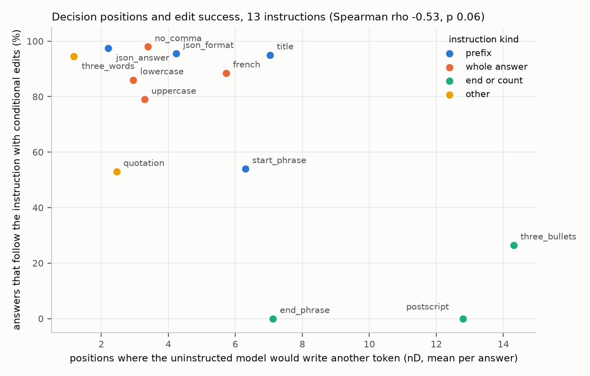

# WSP 재설계 실험 보고 (지시서 E0~E4)

2026-11-16 새벽(KST)에 돌렸다. 대상 모델은 Qwen3.5-0.8B, 생각 과정은 끔, 생성은 greedy에 새 token 96개까지다. 구간은 95% Wilson 구간이다. 표를 만드는 스크립트는 `wsp/redesign_report.py`이고, 도는 중인 실행이 끝나면 다시 돌려 채운다.

## 판정 요약

| 주장 | 지시서의 기준 | 나온 값 | 판정 |
| --- | --- | --- | --- |
| A. 답 전체형 지시문에서 편집이 앞머리 강제를 넘는다 | 소문자, 대문자, 프랑스어 중 둘 이상에서 C5 − C4가 30%p 이상 | 소문자 +12%p, 대문자 +35%p, 프랑스어 -10%p | 서지 않는다. 대문자 하나만 넘었다 |
| B. 결정 자리를 재면 편집 성공을 미리 안다 | nD나 dL과 편집 준수율의 Spearman ρ가 −0.6 이하. 끝·개수형 셋이 dL 상위 셋 | nD ρ -0.53 (p 0.062), dL ρ -0.56 (p 0.046). dL 상위 셋은 추신, bullet 세 개, 정해진 말로 끝내기 | 반만 선다. 상위 셋은 맞았고 ρ는 기준에 조금 못 미친다 |
| C. IWIBench 결과가 코드를 안 보고 쓴 문형으로도 유지된다 | episode 1 점수가 0.76 이상 | episode 1에서 34/64, 점수 0.502 | 서지 않는다. 80개 문형의 0.095보다는 높다 |

## 표 1. E1 앞머리 강제 대조군

질문은 시험 질문 500개 가운데 유형마다 앞 40개씩 200개다. C1은 지시문을 prompt에 넣은 것, C2는 아무것도 없는 것, C3과 C4는 C1이 쓴 답의 첫 4 token과 첫 16 token을 강제로 넣고 이어 쓰게 한 것, C5는 지시문 없이 조건부 편집만 넣은 것이다. 값은 지시문을 지킨 답의 %다.

| 지시문 | 종류 | C1 | C2 | C3 | C4 | C5 | 편집 수 |
| --- | --- | --- | --- | --- | --- | --- | --- |
| JSON, key는 answer | 앞머리 | 100 [98, 100] | 0 [0, 2] | 99 [96, 100] | 100 [98, 100] | 98 [94, 99] | 2 |
| JSON으로 감싸기 | 앞머리 | 100 [98, 100] | 2 [1, 6] | 66 [59, 72] | 72 [65, 78] | 96 [92, 98] | 3 |
| 제목 붙이기 | 앞머리 | 100 [98, 100] | 0 [0, 2] | 99 [96, 100] | 100 [98, 100] | 95 [91, 97] | 4 |
| 정해진 말로 시작 | 앞머리 | 100 [98, 100] | 0 [0, 2] | 22 [17, 29] | 100 [98, 100] | 54 [47, 61] | 4 |
| 소문자 | 답 전체 | 99 [96, 100] | 13 [9, 18] | 45 [38, 52] | 74 [67, 79] | 86 [81, 90] | 3 |
| 대문자 | 답 전체 | 98 [95, 99] | 0 [0, 2] | 43 [36, 50] | 44 [37, 51] | 79 [73, 84] | 2 |
| 프랑스어 | 답 전체 | 98 [96, 99] | 5 [3, 9] | 82 [76, 86] | 98 [96, 99] | 88 [83, 92] | 3 |
| 쉼표 쓰지 않기 | 답 전체 | 99 [96, 100] | 32 [25, 38] | 52 [45, 58] | 64 [58, 71] | 98 [95, 99] | 4 |
| 정해진 말로 끝내기 | 끝·개수 | 70 [64, 76] | 0 [0, 2] | 0 [0, 2] | 8 [5, 13] | 0 [0, 2] | 3 |
| 추신 붙이기 | 끝·개수 | 90 [86, 94] | 0 [0, 2] | 0 [0, 2] | 8 [5, 13] | 0 [0, 2] | 0 |
| bullet 세 개 | 끝·개수 | 100 [97, 100] | 2 [1, 4] | 3 [1, 6] | 16 [11, 21] | 26 [21, 33] | 4 |
| 따옴표로 감싸기 | 기타 | 92 [88, 95] | 2 [1, 6] | 49 [42, 56] | 50 [44, 57] | 53 [46, 60] | 1 |
| 세 단어 이하 | 기타 | 98 [95, 99] | 18 [13, 24] | 73 [66, 79] | 73 [66, 79] | 94 [90, 97] | 2 |

정답 문자열이 든 답의 %

| 지시문 | C1 | C2 | C3 | C4 | C5 |
| --- | --- | --- | --- | --- | --- |
| JSON, key는 answer | 74 | 78 | 76 | 74 | 74 |
| JSON으로 감싸기 | 79 | 78 | 80 | 80 | 78 |
| 제목 붙이기 | 76 | 78 | 76 | 78 | 73 |
| 정해진 말로 시작 | 76 | 78 | 78 | 76 | 76 |
| 소문자 | 52 | 78 | 68 | 64 | 52 |
| 대문자 | 39 | 78 | 61 | 62 | 42 |
| 프랑스어 | 50 | 78 | 56 | 52 | 50 |
| 쉼표 쓰지 않기 | 76 | 78 | 81 | 79 | 48 |
| 정해진 말로 끝내기 | 80 | 78 | 80 | 80 | 77 |
| 추신 붙이기 | 81 | 78 | 78 | 82 | 78 |
| bullet 세 개 | 84 | 78 | 80 | 84 | 82 |
| 따옴표로 감싸기 | 74 | 78 | 80 | 78 | 72 |
| 세 단어 이하 | 74 | 78 | 76 | 77 | 66 |

지시문도 지키고 정답도 든 답의 %

| 지시문 | C1 | C2 | C3 | C4 | C5 | C6 편집과 첫 4 token |
| --- | --- | --- | --- | --- | --- | --- |
| JSON, key는 answer | 74 | 0 | 75 | 74 | 72 | 72 |
| JSON으로 감싸기 | 79 | 2 | 50 | 54 | 75 | 76 |
| 제목 붙이기 | 76 | 0 | 75 | 78 | 68 | 67 |
| 정해진 말로 시작 | 76 | 0 | 15 | 76 | 38 | 78 |
| 소문자 | 51 | 8 | 26 | 41 | 42 | 56 |
| 대문자 | 38 | 0 | 20 | 22 | 34 | 42 |
| 프랑스어 | 50 | 4 | 44 | 51 | 45 | 46 |
| 쉼표 쓰지 않기 | 75 | 23 | 44 | 50 | 46 | 70 |
| 정해진 말로 끝내기 | 57 | 0 | 0 | 8 | 0 | 0 |
| 추신 붙이기 | 74 | 0 | 0 | 7 | 0 | 0 |
| bullet 세 개 | 84 | 2 | 2 | 13 | 26 | 20 |
| 따옴표로 감싸기 | 70 | 2 | 40 | 42 | 39 | 56 |
| 세 단어 이하 | 72 | 11 | 60 | 60 | 64 | 74 |

강제한 앞머리가 참조 답 전체를 덮는 문항이 많다. 그런 문항에서는 C1의 답을 대신 써 준 것과 같아서 지키는 것이 당연하다. 앞머리가 참조 답보다 짧은 문항만 보면 이렇다.

| 지시문 | C3에서 해당 문항 수 | C3 준수 % | C4에서 해당 문항 수 | C4 준수 % | C5 준수 % (200문항) |
| --- | --- | --- | --- | --- | --- |
| JSON, key는 answer | 200 | 99 | 0 | - | 98 |
| JSON으로 감싸기 | 200 | 66 | 167 | 78 | 96 |
| 제목 붙이기 | 165 | 99 | 112 | 100 | 95 |
| 정해진 말로 시작 | 200 | 22 | 91 | 100 | 54 |
| 소문자 | 137 | 25 | 33 | 79 | 86 |
| 대문자 | 120 | 33 | 42 | 33 | 79 |
| 프랑스어 | 182 | 80 | 83 | 100 | 88 |
| 쉼표 쓰지 않기 | 177 | 45 | 22 | 55 | 98 |
| 정해진 말로 끝내기 | 172 | 0 | 139 | 5 | 0 |
| 추신 붙이기 | 200 | 0 | 200 | 8 | 0 |
| bullet 세 개 | 200 | 3 | 192 | 14 | 26 |
| 따옴표로 감싸기 | 118 | 32 | 23 | 9 | 53 |
| 세 단어 이하 | 16 | 56 | 0 | - | 94 |

**주장 A의 판정.** 기준은 소문자, 대문자, 프랑스어 가운데 둘 이상에서 C5가 C4보다 30%p 이상 높고, C5의 정답 비율이 C1보다 10%p 넘게 낮지 않은 것이다. C5와 C4의 차이는 소문자 +12%p, 대문자 +35%p, 프랑스어 −10%p다. 정답 비율은 셋 다 C1과 3%p 안이다. 기준을 넘은 것은 대문자 하나라서 주장 A는 서지 않는다.

지시서의 실패 기준은 답 전체형에서도 C4가 C5와 10%p 안에 드는 것이다. 소문자는 12%p 차이라 경계에 있고 프랑스어는 C4가 더 높다. 그러니 주장을 좁히는 쪽이 맞다.

읽을 때 감안할 것이 하나 있다. 지시문을 넣으면 이 모델의 답이 짧아져서, 첫 16 token이 참조 답 전체인 문항이 많다. 소문자는 200개 중 167개, 대문자는 158개, 프랑스어는 117개가 그렇다. 앞머리가 참조 답보다 짧은 문항만 보면 C4의 준수율은 소문자 79%, 대문자 33%, 프랑스어 100%다. 문항 수가 33개, 42개, 83개로 적다.

표에서 더 읽을 수 있는 것은 넷이다.

- 앞머리형 가운데 JSON과 제목은 첫 4 token만 강제해도 99%다. 편집과 같다. 이 둘에서는 "편집은 앞머리 강제를 가중치로 옮긴 것"이라는 반론이 맞다.
- 첫 4 token 강제와 견주면 편집이 소문자에서 41%p, 대문자에서 36%p 높다. 프랑스어는 6%p 차이다.
- 답 전체형이 아닌 지시문에서도 편집이 첫 16 token 강제보다 높은 것이 있다. JSON으로 감싸기가 96% 대 72%, 세 단어 이하가 94% 대 73%다. 쉼표 쓰지 않기는 98% 대 64%인데 정답이 48%로 C1의 76%보다 크게 낮아서 편집의 성공으로 치기 어렵다.
- 끝·개수형 셋은 어느 방법으로도 안 된다. 정해진 말로 시작하기는 첫 16 token을 강제하면 100%인데 편집은 54%다. 이 말이 일곱 token이라 편집이 일곱 번 들어가야 하는데 넷까지만 쌓았다. 여덟까지 쌓은 실행에서도 57%에 그쳤다.

좁힌 주장은 이렇게 된다. 조건부 편집은 답의 앞머리를 정해 주는 일을 가중치로 옮긴다. 앞머리 몇 token으로 정해지는 형식에서는 지시문 수준이 나오고, 답 전체에 걸치는 형식에서는 대문자처럼 앞머리 강제보다 나은 경우가 있지만 일반적이지 않다.

## 표 2. E2 결정 자리 측정

d1은 C1의 답과 C2의 답이 처음 달라지는 token 위치를 C1 답의 길이로 나눈 값이다. nD는 C1의 답을 지시문 없는 모델에 넣었을 때, 그 모델이 고를 token이 C1의 token과 다른 자리의 수다. dL은 그런 자리 가운데 마지막 자리의 상대 위치다. 셋 다 질문 200개의 평균이고 편집을 만들기 전의 원래 모델에서 잰다. nD는 지시서와 달리 200개 전부에서 쟀다.

| 지시문 | 종류 | d1 | nD | dL | 참조 답의 길이 | 편집 준수율 % | 편집 수 |
| --- | --- | --- | --- | --- | --- | --- | --- |
| JSON, key는 answer | 앞머리 | 0.00 | 2.2 | 0.29 | 7.3 | 97.5 | 2 |
| JSON으로 감싸기 | 앞머리 | 0.00 | 4.2 | 0.58 | 26.6 | 95.5 | 3 |
| 제목 붙이기 | 앞머리 | 0.00 | 7.0 | 0.72 | 38.5 | 95.0 | 4 |
| 정해진 말로 시작 | 앞머리 | 0.00 | 6.3 | 0.78 | 24.8 | 54.0 | 4 |
| 소문자 | 답 전체 | 0.02 | 3.0 | 0.55 | 10.5 | 86.0 | 3 |
| 대문자 | 답 전체 | 0.00 | 3.3 | 0.50 | 10.3 | 79.0 | 2 |
| 프랑스어 | 답 전체 | 0.02 | 5.7 | 0.73 | 23.9 | 88.5 | 3 |
| 쉼표 쓰지 않기 | 답 전체 | 0.16 | 3.4 | 0.67 | 10.9 | 98.0 | 4 |
| 정해진 말로 끝내기 | 끝·개수 | 0.11 | 7.1 | 0.79 | 25.7 | 0.0 | 3 |
| 추신 붙이기 | 끝·개수 | 0.08 | 12.8 | 0.89 | 76.0 | 0.0 | 0 |
| bullet 세 개 | 끝·개수 | 0.00 | 14.3 | 0.87 | 49.5 | 26.5 | 4 |
| 따옴표로 감싸기 | 기타 | 0.02 | 2.5 | 0.40 | 8.7 | 53.0 | 1 |
| 세 단어 이하 | 기타 | 0.08 | 1.2 | 0.14 | 2.4 | 94.5 | 2 |

| 견준 것 | Spearman ρ | p | n |
| --- | --- | --- | --- |
| d1와 편집 준수율 | -0.17 | 0.579 | 13 |
| d1와 편집 수 | -0.27 | 0.376 | 13 |
| nD와 편집 준수율 | -0.53 | 0.062 | 13 |
| nD와 편집 수 | 0.43 | 0.146 | 13 |
| dL와 편집 준수율 | -0.56 | 0.046 | 13 |
| dL와 편집 수 | 0.39 | 0.192 | 13 |

**주장 B의 판정.** 기준은 둘이다. nD나 dL과 편집 준수율의 Spearman ρ가 −0.6 이하일 것, 그리고 끝·개수형 세 지시문이 dL 상위 셋에 들 것이다. dL 상위 셋은 추신 붙이기, bullet 세 개, 정해진 말로 끝내기로 정확히 끝·개수형 셋이다. ρ는 dL이 −0.56, nD가 −0.53으로 방향은 맞지만 −0.6에 못 미친다. 지시문이 13개라 p값은 0.046과 0.062다. 실패 기준인 절댓값 0.3 미만도 아니다. 그래서 주장 B는 반만 선다. "끝에서 정해지는 지시문은 dL이 크고 편집이 안 된다"까지는 말할 수 있고, "측정값으로 준수율을 맞힌다"고 하기에는 모자란다.

측정값이 가르지 못하는 쌍이 있다. 제목 붙이기와 정해진 말로 시작하기는 nD가 7.0과 6.3, dL이 0.72와 0.78로 비슷한데 편집 준수율은 95%와 54%다. 편집 수와의 상관은 nD가 0.43, dL이 0.39이고 p값이 0.15와 0.19라서 편집이 몇 개 필요한지를 미리 맞힌다고 말할 근거는 없다. d1은 거의 모든 지시문에서 0에 가까워서 아무것도 가르지 못한다. 지시문을 넣으면 거의 항상 첫 token부터 달라지기 때문이다.

## 표 3. E4 누수 없는 문형으로 IWIBench

과제는 IWIBench의 구조화된 응답이고 문항과 채점기는 그 저장소의 것이다. 대상 모델은 Qwen3.5-0.8B다. 4-gram 겹침은 문형의 4-gram 가운데 채점 문항 192개에도 나오는 것의 비율이다.

| 편집을 만든 문형 | episode 1 | 세 episode | 4-gram 겹침 |
| --- | --- | --- | --- |
| 우리가 쓴 80개 | 8/64, 점수 0.095 | 30 / 192, 평균 점수 0.112 | 0.92% |
| 코드를 본 뒤 쓴 376개 | 64/64, 점수 0.945 | 192 / 192, 평균 점수 0.971 | 1.57% |
| 코드를 본 뒤 쓴 376개에서 채점 문항의 낱말을 뺀 것 | 64/64, 점수 0.927 | 187 / 192, 평균 점수 0.945 | 1.76% |
| 코드를 안 보고 쓴 376개 (E4a) | 34/64, 점수 0.502 | 100 / 192, 평균 점수 0.494 | 0.46% |

**주장 C의 판정.** 기준은 코드를 안 보고 쓴 376개 문형의 episode 1 점수가 0.76 이상인 것이다. 나온 점수는 0.502이고 목표 문항 64개 중 34개를 맞혔다. 기준에 못 미치므로 주장 C는 서지 않는다. 다만 80개 문형일 때의 episode 1 점수 0.095보다는 높아서, 문형이 벤치와 맞아서만 나온 결과라고 하기도 어렵다. 세 episode를 다 돌리면 34/64, 4/64, 62/64로 192문항 중 100문항이고 평균 점수는 0.494다. episode마다 key 이름이 다른데 결과가 크게 갈린다.

틀린 30문항을 열어 봤다. 29문항은 편집이 켜져서 JSON 꼴로 답했는데 `{name: "Elena Lewis"}`처럼 첫 token이 `{"`가 아니라 `{`였다. 그 뒤에서는 key 이름을 쓰는 편집이 켜지지 않아 key가 `name`이 됐다. 산문으로 답한 것은 1문항이다. 그러니 처음 본 말투에서도 답 시작 자리의 편집은 64문항 중 63문항에서 켜졌고, 실패는 첫 token이 조금 어긋나는 데서 났다. 통제 문항 유지는 0.945로 코드를 본 문형일 때와 같다.

E4a는 지시서와 다르게 했다. 서버에 OpenAI key가 없어서 GPT API 대신 새로 띄운 Claude agent에게 시켰다. 이 agent에게는 IWIBench 논문 2.2.6절의 과제 설명, 논문 표의 한 줄, episode의 목표 문장만 줬고 파일을 읽지 말라고 했다. 받은 376개는 이름 추출 192개, 산문을 요구하는 이름 추출 64개, 일반 질문 120개다. 중복은 없었고, 사람 이름이 채점 문항의 이름과 겹쳐서 뺀 것도 없었다. 가장 가까운 문장 쌍은 `results/E4/E4a_leak_check.json`에 있다.

참고로 대조 실험을 하나 더 돌렸다. 코드를 본 뒤 쓴 문형에서 채점 문항의 낱말인 Extract, note, Which, profile을 빼고 다시 만든 편집이다. 이 경우는 세 episode에서 192문항 중 187문항을 맞혔다.

episode 2에서 4문항만 맞은 까닭도 봤다. 이 episode의 기록은 "A resident named Felix Parker has a home in Dublin. Their occupation is gardening." 꼴이다. 편집된 모델은 여기서 `Felix Parker`라고만 답했다. 답 시작 자리의 편집이 켜지지 않은 것이다. 코드를 본 뒤 쓴 문형으로 만든 편집은 같은 문항 64개를 다 맞혔다. 그러니 episode 1의 실패와 episode 2의 실패는 종류가 다르다. 앞의 것은 편집이 켜졌지만 첫 token이 어긋난 것이고, 뒤의 것은 처음 보는 기록 꼴에서 편집이 아예 켜지지 않은 것이다.

지시서 밖에서 두 가지를 더 해 봤다. 둘 다 기준을 넘기지는 못했다.

- 답 시작 자리의 편집을 1.25배에서 3배로 키웠다. 이름을 뽑는 문장에서 지시문 있는 모델과 같은 답이 80%에서 92%로 늘었지만, 다른 문장에서 원래 모델과 같은 답이 50%에서 7%로 줄었다. 우리 문장으로 고른 배율은 1배 그대로였다. `results/E4/extra_scaled_first_edit.json`.
- 편집된 모델이 둘째로 유력하게 보는 첫 token으로 시작하는 답도 따라가며 편집을 쌓았다. episode 1이 34/64에서 39/64가 됐고 episode 2는 4/64 그대로다. `results/E4/extra_explore_qwen35-0.8b/`.

## E0. 편집을 빼면 원래 가중치로 돌아가는가

JSON 지시문의 편집 둘을 `down_proj` 행렬 24개에 더한 뒤 같은 순서로 뺐다. 원소는 모두 88,080,384개다.

| 수 형식 | 원래와 다른 원소 수 | 가장 큰 차이 | 일반 글 10,240 token에서 원래 모델과의 평균 KL |
| --- | --- | --- | --- |
| float32 | 8,540,060 (9.7%) | 3.0e-08 | 8.5e-10 |
| float16 | 10,465,110 (11.9%) | 1.2e-04 | 3.8e-08 |
| bfloat16 | 10,635,763 (12.1%) | 9.8e-04 | 2.3e-06 |

float32에서도 다른 원소가 0개가 아니다. 다만 가장 큰 차이가 3.0×10⁻⁸이고 모델 출력의 KL이 10⁻⁹ 수준이다. float32에서 a에 b를 더했다가 b를 빼면 마지막 자리가 반올림되어 a로 정확히 돌아오지 않는 일이 흔하다. 그래서 이것은 반올림이고, 구현이 덧셈이 아니라는 뜻이 아니다. 코드는 `W + scale * outer(u, v)`를 계산해 저장한다. `wsp/lm.py`의 `add_rank1`이다.

float16과 bfloat16에서는 다른 원소가 1,050만 개 안팎이다. 표현할 수 있는 가장 가까운 값으로 몇 칸 어긋났는지 세면 float16은 1칸이 8,242,743개, 2칸이 1,346,207개, 3칸이 289,630개, 4칸이 147,985개, 5칸 이상이 300,743개다. bfloat16은 1칸이 8,169,181개, 2칸이 1,413,368개, 5칸 이상이 473,238개다. 넣었다 뺀 모델의 출력은 원래 모델과 거의 같다. 평균 KL이 bfloat16에서 2.3×10⁻⁶이다.

결론은 "뺐는데도 720만 개가 다르다"가 저정밀 반올림 때문이라는 것이다. 편집을 되돌릴 수 있어야 하면 원래 행렬에 녹이지 말고 u와 v를 따로 들고 있으면 된다. u와 v는 이미 float32로 `edits.npz`에 저장하고 있다.

## E3. LoRA 비교

| 지시문 | 방법 | 준수율 % | 정답 % | 둘 다 % | 일반 글에서의 평균 KL | 만드는 데 든 시간 |
| --- | --- | --- | --- | --- | --- | --- |
| JSON, key는 answer | LoRA rank 4, 지시서 설정: lr 1e-4, 1 epoch, 38 step | 100 [98, 100] | 72.5 | 72.5 | 0.0027 | 학습 9.0초 |
| JSON, key는 answer | LoRA rank 4, 우리가 더한 설정: lr 1e-3, 5 epoch, 190 step | 100 [97, 100] | 72.5 | 72.5 | 0.0462 | 학습 47.0초 |
| JSON, key는 answer | 조건부 편집 2개, 훈련 없음 | 98 [94, 99] | 74 | 72 | 0.0201 (10만 token에서 잰 값) | forward pass만, 편집 하나에 1분쯤 |
| 소문자 | LoRA rank 4, 지시서 설정: lr 1e-4, 1 epoch, 38 step | 99 [96, 100] | 58.0 | 57.5 | 0.0056 | 학습 9.9초 |
| 소문자 | LoRA rank 4, 우리가 더한 설정: lr 1e-3, 5 epoch, 190 step | 98 [94, 99] | 60.0 | 57.5 | 0.4047 | 학습 38.5초 |
| 소문자 | 조건부 편집 3개, 훈련 없음 | 86 [81, 90] | 52 | 42 | 재지 않음 | forward pass만, 편집 하나에 1분쯤 |

지시서의 설정 그대로인 LoRA가 9초 학습으로 JSON 100%, 소문자 99%를 냈다. 같은 200문항에서 조건부 편집은 98%와 86%다. 일반 글에서의 KL도 LoRA가 0.003과 0.006으로 작다. JSON 편집 둘은 0.020이었고 소문자 편집은 재지 않았다. 그러니 이 두 지시문에서는 짧게 학습한 LoRA가 조건부 편집보다 준수율도 높고 부작용도 작다. 훈련을 쓰지 않는다는 점이 비용의 이익이 되지는 않는다.

감안할 차이는 둘이다. LoRA는 지시문 있는 모델의 답 300쌍으로 학습했고 편집은 질문 64개로 만들었다. 그리고 학습을 길게 하면 부작용이 커진다. lr을 10배로 하고 5 epoch 돌리면 일반 글에서의 KL이 0.046과 0.40으로 뛴다. 학습 데이터를 64쌍으로 줄였을 때의 LoRA는 돌리지 않았다.

## 먼저 돌리던 실행의 최신 숫자

### 모든 자리에 더하는 steering을 다시 조정한 것

layer와 배율을 조정용 질문 40개에서 "지시문도 지키고 정답도 든 비율"로 골랐다. 처음에는 지시문을 지킨 비율만 보고 골라서, 형식만 맞고 답이 망가진 설정이 뽑힌 지시문이 있었다. 시험 질문 500개에서 잰 값이고, 칸마다 지킨 % / 정답 % / 둘 다 %다.

| 지시문 | 지시문을 넣음 | 모든 자리에 더함, 다시 조정 | 조건부 편집, 쌓은 것 전부 |
| --- | --- | --- | --- |
| JSON, key는 answer | 100 / 76 / 76 | 0 / 79 / 0 | 96 / 76 / 73 |
| JSON으로 감싸기 | 100 / 78 / 78 | 22 / 44 / 19 | 97 / 78 / 76 |
| 제목 붙이기 | 100 / 72 / 72 | 1 / 79 / 0 | 95 / 69 / 63 |
| 정해진 말로 시작 | 100 / 79 / 79 | 0 / 79 / 0 | 55 / 76 / 39 |
| 소문자 | 99 / 53 / 52 | 98 / 65 / 64 | 86 / 53 / 44 |
| 대문자 | 97 / 40 / 39 | 80 / 60 / 51 | 78 / 42 / 32 |
| 프랑스어 | 97 / 48 / 47 | 81 / 37 / 27 | 89 / 51 / 45 |
| 쉼표 쓰지 않기 | 99 / 73 / 72 | 96 / 76 / 73 | 99 / 49 / 48 |
| 정해진 말로 끝내기 | 71 / 81 / 59 | 0 / 79 / 0 | 0 / 78 / 0 |
| 추신 붙이기 | 88 / 83 / 72 | 0 / 80 / 0 | 편집 없음 |
| bullet 세 개 | 100 / 82 / 82 | 16 / 78 / 15 | 24 / 81 / 24 |
| 따옴표로 감싸기 | 92 / 76 / 71 | 37 / 48 / 18 | 56 / 69 / 38 |
| 세 단어 이하 | 98 / 72 / 71 | 82 / 74 / 64 | 95 / 67 / 65 |

### IWIBench의 다른 실행

| 모델 | 편집을 만든 문형 | episode별 목표 문항과 점수 | 합계 |
| --- | --- | --- | --- |
| Qwen3.5-0.8B | 코드를 본 뒤 쓴 376개 | 64/64 (0.945), 64/64 (0.983), 64/64 (0.983) | 192 / 192, 평균 점수 0.971 |
| Qwen3.5-0.8B | 같은 문형에서 채점 문항의 낱말을 뺀 것 | 64/64 (0.927), 59/64 (0.906), 64/64 (1.000) | 187 / 192, 평균 점수 0.945 |
| Qwen3.5-0.8B | 낱말을 뺀 문형, 벤치의 test split episode | 63/64 (0.984), 11/64 (0.169), 64/64 (0.982) | 138 / 192, 평균 점수 0.712 |
| Qwen3.5-4B | 코드를 본 뒤 쓴 376개, episode 1만 | 64/64 (1.000) | 64 / 64, 평균 점수 1.000 (episode 1개만 끝남) |
| Gemma 3 4B | 코드를 본 뒤 쓴 376개 | 도는 중 | 도는 중 |
| Gemma 3 4B | 코드를 안 보고 쓴 376개 | 도는 중 | 도는 중 |

Gemma 3 4B는 IWIBench가 대상으로 쓴 모델이다. 약관 동의를 받은 뒤 02:25에 띄웠다. 이 모델은 지시문을 넣어도 JSON을 code fence로 감싸서 내기 때문에, 지시문 끝에 "Do not use markdown or code fences."를 붙였다. 우리가 만든 문장 24개에서 이 문구일 때만 24개가 맞았다.

Gemma에서는 Qwen에서 쓰던 편집을 그대로 넣자 모델이 망가졌다. 첫 episode에서 목표 문항 0/64, 통제 문항 유지 0.0이었다. Gemma 3는 MLP 출력을 RMSNorm에 통과시킨 뒤 residual에 더하는데, 편집은 그 정규화 앞에 vector를 더하기 때문이다. 정규화를 거꾸로 계산해서 더할 vector를 정하도록 고쳤고(`wsp/lm.py`의 `to_pre_norm`), 위 표의 Gemma 줄은 고친 방법으로 02:43에 다시 띄운 실행이다.

벤치의 test split episode는 사람 이름, key 이름, 요청 문장이 development split과 다르다. 여기서는 episode마다 결과가 크게 갈렸다.

### 그 밖의 숫자

- **Qwen3.5-4B의 JSON 지시문.** 편집 셋으로 key 이름까지 맞은 JSON이 91.0%, 구간은 88.6에서 93.4다. 지시문을 넣으면 100%다. 4B에서는 갈라지는 자리가 `{"`, `answer`, `":` 셋이었다.
- **정해진 말로 시작하기, 편집 여덟 개까지.** 편집 수 1부터 8까지 준수율이 0.0, 2.4, 32.6, 54.6, 55.2, 55.6, 56.6, 57.2%다. 넷째 편집 뒤로는 거의 오르지 않는다.
- **긴 문서 뒤.** 질문 앞에 상관없는 문서를 끼웠을 때 JSON 편집 둘의 준수율은 문서가 없으면 97%, 1,000 token이면 83%, 4,000 token이면 85%, 16,000 token이면 93%다. 지시문을 넣은 쪽은 99%에서 100%다. 질문은 100개다.
- **일반 글.** 10만 token에서 편집의 v와 h의 곱이 0.5를 넘은 자리는 없었다.

## 기본값을 쓴 곳, 줄인 곳, 못 한 것

지시서와 다르게 한 곳을 전부 적는다.

- **하드웨어와 정밀도.** Colab T4와 fp16이 아니라 서버의 GPU 2, 3번에서 float32로 계산했다. 가중치의 값은 공개된 bfloat16 값 그대로다. bfloat16으로 계산하면 배치 크기에 따라 greedy 출력이 달라졌기 때문이다.
- **질문 200개.** 시험 질문이 유형 순서로 놓여 있어서 앞 200개는 두 유형뿐이다. 그래서 다섯 유형에서 앞 40개씩 뽑았다. 기본값 사용.
- **C5의 편집.** 지시문마다 이미 만들어 둔 편집을 쌓은 것 전부 넣었다. 추신 붙이기는 만든 편집이 없어서 C5가 C2와 같다. JSON은 편집 둘이고 각각 layer 24개에 rank-1 변경이 하나씩이다.
- **E0.** fp16에 더해 공개된 가중치의 형식인 bfloat16도 쟀다.
- **E2.** nD를 질문 50개가 아니라 200개 전부에서 GPU로 쟀다.
- **E4a.** GPT API 대신 새로 띄운 Claude agent를 썼다. 서버에 OpenAI key가 없었다. 기본값 사용.
- **E3.** 지시서의 설정에 더해 lr 1e-3, 5 epoch 설정을 하나 더 돌렸다. LoRA는 가중치에 합치지 않고 hook으로 적용해서 쟀다.
- **C6.** 선택 항목이었고 돌렸다.
- **못 한 것.** 지시서의 실험 가운데 못 한 것은 없다. 이 보고서를 처음 쓴 시각에 E4b의 episode 2와 3, Gemma 3 4B는 아직 도는 중이었고, 위 표에 "도는 중"으로 적힌 칸은 끝나는 대로 채운다.

